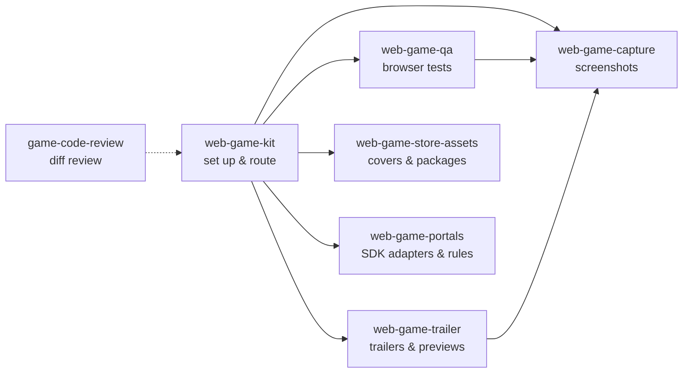

<p align="center">
  
</p>

<h1 align="center">Web Game Skills</h1>

<p align="center">
  <strong>Build it. Test it. Ship it to every portal.</strong><br>
  A complete Claude Code toolkit for building and shipping browser games — three.js, canvas, Vite — on game portals.
</p>

<p align="center">
  
  
  
  
  
</p>

<p align="center">
  
</p>

Shipping a browser game is not one job, it is six: scaffolding the project, screenshotting it on real device sizes, testing it in a browser, filming trailers and preview videos, making store covers and upload packages, and integrating each portal's SDK with its own ad and save rules. These seven Claude Code skills split that work the way it actually happens — one skill per speciality, each with tested scripts instead of vibes — and they carry the portal knowledge (requirements, ad rules, submission forms, launch metrics, and the traps that cost a launch day) as written references next to the code.

## Quick start

```sh
# 1. Get the toolkit and install it into Claude Code
gh repo clone eslamnegm010/web-game-skills ~/.web-game-skills
~/.web-game-skills/install.sh web-game

# 2. Scaffold a game project (from the project's root)
~/.claude/skills/web-game-kit/init-game.sh "My Game" mygame_

# 3. Run the starter browser tests
~/.claude/skills/web-game-qa/run.sh
```

Step 2 adds the platform layer (`src/platform/`), starter test suites (`tools/e2e/`) and the store kit (`docs/store/`) — nothing is ever overwritten. Step 3 builds the game, serves it, and drives muted headless Chrome through the suites; a green run ends like this:

```
3 suites · 25 passed · 0 failed · screenshots: /tmp/mygame-e2e
```

Start a new Claude Code session after installing, then just ask for the work — *"take a phone screenshot"*, *"film the preview videos"*, *"package it for CrazyGames"* — each skill triggers on its task.

## Contents

- [The pipeline](#the-pipeline)
- [The skills](#the-skills)
- [Portals](#portals)
- [Installation](#installation)
- [Shipping a game, end to end](#shipping-a-game-end-to-end)
- [Repository layout](#repository-layout)
- [Requirements](#requirements)
- [Troubleshooting](#troubleshooting)
- [Design principles](#design-principles)
- [Credits](#credits)

## The pipeline

One skill, one speciality — the kit routes each job to the right one:



## The skills

| Skill | What it does |
| --- | --- |
| [`web-game-kit`](skills/web-game-kit) | Entry point: sets up a game project in one command and routes work to the right skill |
| [`web-game-capture`](skills/web-game-capture) | Screenshots and browser control in muted headless Chrome: desktop, phones, tablets |
| [`web-game-qa`](skills/web-game-qa) | Browser test suites: smoke, devices, portal SDK integration against a fake SDK |
| [`web-game-trailer`](skills/web-game-trailer) | Frame-by-frame gameplay recording, trailers, portal preview videos |
| [`web-game-store-assets`](skills/web-game-store-assets) | Upload packages, covers, listing text, asset validation |
| [`web-game-portals`](skills/web-game-portals) | Platform layer and portal knowledge: CrazyGames (default), Y8, GamePix, Playgama, and a procedure for any other portal |
| [`game-code-review`](skills/game-code-review) | Review a diff of game code (web/three.js) for frame-path allocations, resource lifecycle, state bugs, and agent-written mistakes; severity-ranked report (adapted, MIT) |

### web-game-kit — set up and route

```sh
init-game.sh "Game Name" gamename_ [--skip platform,tests,store] [--portals "crazygames y8"]
```

Runs each skill's own setup for the project (platform layer, starter suites, store kit), then routes later work: a request lands in the skill that owns it.

### web-game-capture — screenshots and browser control

Drives muted headless Chrome over the DevTools protocol — no dependencies beyond Node. Devices are built in: `iphone`, `android`, `ipad`, `chromebook`, `desktop`.

```sh
with-preview.sh -- node shot.mjs / out.png --wait '!!window.__game'
with-preview.sh -- node shot.mjs '?debug' phone.png --device iphone --landscape --wait '!!window.__game'
```

`with-preview.sh` builds the game (never the dev server — hot reload restarts pages mid-run), serves the build on a free port, runs your command with `URL` set, and stops the server. `lib/browser.mjs` is the shared driver the QA and trailer skills are built on: it waits on conditions, never on fixed sleeps, and always kills its Chrome.

### web-game-qa — browser test suites

```sh
run.sh                 # every suite in tools/e2e/
run.sh smoke devices   # only those
```

A suite is a file `tools/e2e/<name>.e2e.mjs`; a file named `<name>.<portal>.e2e.mjs` runs against that portal's build. The starter suites cover boot/smoke, device viewports, and portal SDK integration — the CrazyGames one runs against a **fake SDK** shipped here, so SDK calls are tested without the real portal. Exit code 1 when any check fails; screenshots land in `$OUT/<suite>/`.

### web-game-trailer — trailers and preview videos

Recording is frame-by-frame under a fake clock (`record.mjs` + a small *director* script that plays the game), so every frame is rendered however slow the machine is — no dropped frames, no stutter.

```sh
record.mjs <url> <frames dir> --director <file.js> [--fps 60] [--size 2560x1440]
cut.sh trailer <frames dir> <out.mp4> [--audio file] [--cover image]
cut.sh preview <frames dir> <cover image> <out.mp4> [--size 1920x1080] [--max 20]
cut.sh sheet   <frames dir> <out.jpg>     # a contact sheet, to judge a take at a glance
```

### web-game-store-assets — covers, packages, checks

```sh
title-cover.py --title "MY|GAME" --art <dir> --out <dir>   # 1920x1080, 800x1200, 800x800 covers
package.sh crazygames        # -> release/<name>-crazygames/ and .zip, sizes checked against portal limits
check-assets.sh docs/store   # covers and preview videos against the portal's rules, PASS/FAIL per item
```

The store kit in `docs/store/` (`LISTING.md`, `SUBMISSIONS.md`) is filled in as you submit, so every portal's values and surprises are written down, not remembered.

### web-game-portals — SDK adapters and portal knowledge

Game code never calls a portal SDK or `localStorage`. It talks to one `platform` object (ads, cloud saves, lifecycle signals, username, site mute); the portal is chosen at build time by `VITE_PLATFORM` and the other adapters drop out of the bundle.

```sh
init.sh mygame_ crazygames     # the platform layer + first portal
add-platform.sh y8             # a portal this skill knows: its tested adapter
add-platform.sh poki PokiSDK   # any other portal: a skeleton, after researching it
```

Each portal's reference covers its technical and ad rules, the submission form field by field, QA tooling, metrics and payouts — and the hard lessons (a lobby before play inflates measured load time; a cover is the first metric; some rejection emails are procedural). A portal with no reference yet starts with `references/new-portal.md`: research first, write the reference, *then* write code.

### game-code-review — diff review for game code

Reviews a change the way a game codebase breaks: allocations on the frame path, resources created and never disposed, state bugs, and the mistakes agent-written code repeats. Findings come back severity-ranked. Adapted from AlterLab GameForge (MIT).

## Portals

| Portal | Adapter | Reference | Notes |
| --- | --- | --- | --- |
| CrazyGames | ✅ | ✅ full | The default. Basic Launch first: open to everyone, real metrics in days |
| Y8 | ✅ | ✅ | SDK in `<head>`, initialised on its ready event |
| GamePix | ✅ | ✅ | SDK v3, manual lifecycle; relative paths only, fonts bundled |
| Playgama | ✅ | ✅ full | Bridge SDK: cloud storage, Sandbox certification, 30-day metric targets |
| Poki, GameDistribution, Yandex, itch.io, … | skeleton | field notes | Added through the research procedure in `new-portal.md` |

## Installation

```sh
gh repo clone eslamnegm010/web-game-skills ~/.web-game-skills
~/.web-game-skills/install.sh web-game
```

| Command | What it does |
| --- | --- |
| `install.sh` | List bundles and skills, and what is installed |
| `install.sh web-game` | Install the bundle (a skill's requirements come along automatically) |
| `install.sh web-game-qa …` | Install individual skills |
| `install.sh --all` | Install everything |
| `install.sh --update` | `git pull`, then relink what is installed |
| `install.sh --remove <skill> …` | Remove skills installed from here |

Options: `--copy` copies instead of linking · `--force` replaces a same-named skill that came from elsewhere (the old one is moved to `~/.claude/skills-backup/<time>/`) · `CLAUDE_SKILLS_DIR=<dir>` installs somewhere other than `~/.claude/skills`.

Skills are **linked** into `~/.claude/skills/` where the shell may create symlinks, so `git pull` updates them in place. On Windows without symlink privilege (no Developer Mode, not an admin shell), Git Bash's `ln -s` would silently copy instead — `install.sh` detects that, copies deliberately, and says so; re-run `install.sh --update` after a pull in that case.

## Shipping a game, end to end

1. **Scaffold**: `init-game.sh "Game Name" gamename_` — platform layer, suites, store kit.
2. **Wire the game**: `await platform.init()` at boot, `platform.storage` instead of `localStorage`, `gameplayStart/Stop` around real play, ads only at natural breaks (the portals reference has each portal's exact rules).
3. **Test**: `run.sh` until green — smoke, devices, and the SDK suite against the fake SDK.
4. **Look at it**: `shot.mjs` on phone and desktop sizes; a game that only exists in test output is not done.
5. **Film**: `record.mjs` a take, `cut.sh trailer` and `cut.sh preview` (landscape *and* portrait) for the listing.
6. **Store kit**: `title-cover.py` for covers, fill `docs/store/LISTING.md`, `check-assets.sh` until it passes.
7. **Package and submit**: `package.sh <portal>`, upload, run the portal's own QA tool, submit — and write what happened into `docs/store/SUBMISSIONS.md`.
8. **After launch**: read the metrics per device daily, change one thing at a time, and feed what you learn back into the portal's reference here.

Or skip the manual path: with the skills installed, Claude Code runs this whole flow from plain requests.

## Repository layout

```
.
├── install.sh            # installer: bundles, links or copies skills into ~/.claude/skills
├── skills.json           # bundles and the requires map between skills
└── skills/
    ├── web-game-kit/         # entry point: init-game.sh + routing
    ├── web-game-capture/     # shot.mjs, with-preview.sh, lib/browser.mjs (the Chrome driver)
    ├── web-game-qa/          # run.sh, starter suites, the fake CrazyGames SDK
    ├── web-game-trailer/     # record.mjs, mix.mjs, cut.sh, director templates
    ├── web-game-store-assets/# package.sh, check-assets.sh, title-cover.py, store kit templates
    ├── web-game-portals/     # platform templates (one adapter per portal) + references/
    └── game-code-review/     # diff review (adapted, MIT — see its LICENSE)
```

## Requirements

| Need | For | Notes |
| --- | --- | --- |
| Node 22+ | everything | The `.mjs` tools have no other dependencies |
| Chrome, Chromium or Edge | capture, QA, trailer | Found automatically; override with `CHROME=/path/to/browser` |
| `git` | installer, project setup | |
| `ffmpeg` (+ `ffprobe`) | trailer, asset checks | macOS `brew install ffmpeg` · Windows `winget install ffmpeg` · Linux your package manager |
| Python 3 + Pillow | covers, contact sheets | `pip install Pillow`; `python3` on macOS/Linux, `python`/`py` on Windows |

The scripts run on **macOS, Linux and Windows**. On Windows, run the `.sh` scripts from **Git Bash** (it ships with [Git for Windows](https://gitforwindows.org/)) or from WSL — not from PowerShell or cmd.

## Troubleshooting

**`Permission denied` when running a script.** The copy lost its executable bit (some download/clone paths drop it). Run it as `bash <script>` — the scripts call each other that way internally, so only the first command needs it.

**`Chrome not found`.** No Chrome/Chromium/Edge was found in the standard locations. Install one, or point at it: `CHROME=/path/to/chrome`.

**`python 3 not found` on Windows, although Python is installed.** Windows ships Store stubs named `python.exe`/`python3.exe` that fail with exit code 9009. The scripts probe each candidate and skip the stubs; if it still fails, install Python from python.org (the `py` launcher is the reliable entry) or turn off the Store aliases under *Settings → Apps → Advanced app settings → App execution aliases*.

**Skills were copied, not linked, on Windows.** Your shell may not create symlinks (Developer Mode off, not elevated). Copies work fine; just re-run `install.sh --update` after pulling updates — or enable Developer Mode and reinstall for live links.

**A suite fails with "Chrome did not start" in a container or CI.** Chrome needs `--no-sandbox` when running as root. Point `CHROME` at a small wrapper script that adds it, or run as a normal user.

**The zip from `package.sh` looks odd.** It is never made with PowerShell's `Compress-Archive` (its entry names use backslashes and break uploads): the order is `zip`, then Windows' own `tar.exe`, then Python — all produce standard forward-slash entries.

## Design principles

- **Scripts stay in the skill; projects hold only what is theirs.** A project gets its tests, its trailer script and its platform layer (which ships with the game). Runners, drivers and fake SDKs are shared, so a fix reaches every project at once.
- **One skill, one speciality.** A skill that needs another says so in `skills.json`, and the installer brings it along.
- **Portals are adapters.** The game talks to one `platform` object; each portal is a file chosen at build time. CrazyGames is the default; a new portal starts with research and a written reference, not with code.
- **Everything is checked by a script where a script can check it** (asset sizes, video length, bundle limits, SDK calls) and says plainly what still needs a person's eye.

## Credits

`game-code-review` is adapted from [AlterLab GameForge](https://github.com/alterlab-ieu/alterlab_gameforge) (MIT — see the skill's `LICENSE`). Everything else is original work, extracted from the `agent-skills` collection as the standalone web-game set.
