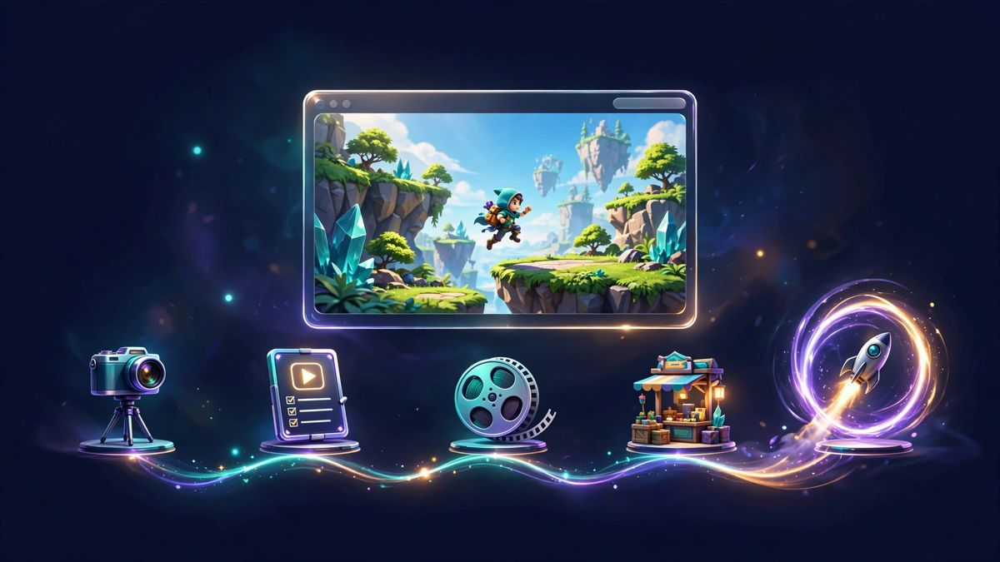
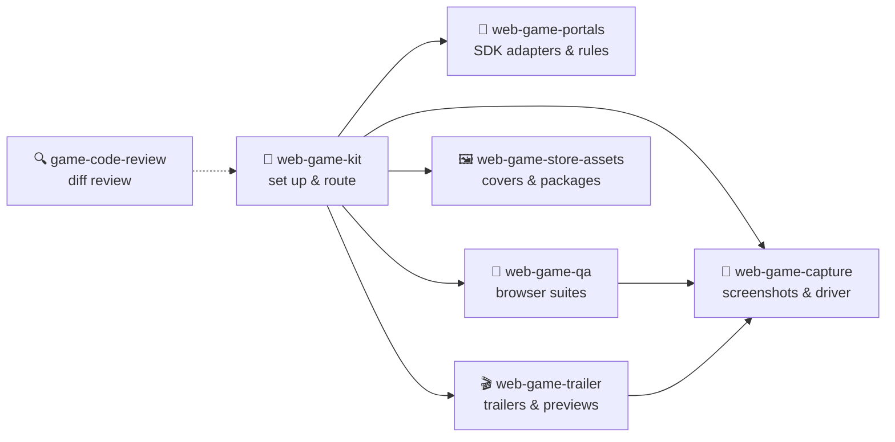
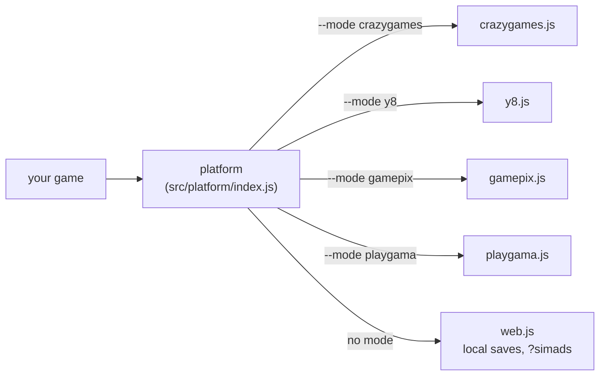

<p align="center">
  
</p>

<h1 align="center">Web Game Skills</h1>

<p align="center">
  <strong>From <code>git init</code> to a live portal launch — without leaving Claude Code.</strong><br>
  Seven skills that build, test, film, package and ship browser games (three.js, canvas, Vite) to game portals.
</p>

<p align="center">
  <a href="https://github.com/eslamnegm010/web-game-skills/actions/workflows/ci.yml"></a>
  
  
  
  
  
  
</p>

<p align="center">
  <a href="#-quick-start">Quick start</a> ·
  <a href="#-just-ask">Just ask</a> ·
  <a href="#-the-seven-skills">The skills</a> ·
  <a href="#-portals">Portals</a> ·
  <a href="#-shipping-a-game-end-to-end">End to end</a> ·
  <a href="#-installation">Install</a> ·
  <a href="#-faq">FAQ</a>
</p>

<p align="center">
  
</p>

> **Finishing the game is half the work.** The other half is screenshots on every device size, a browser test suite, two preview videos in two orientations, three covers, a zip a portal will actually accept, an SDK with its own ad rules, and a long submission form for every portal. This toolkit gives each of those jobs a skill with **scripts that run** and **portal knowledge written down**, so Claude Code does them the same way every time.

## ✨ Why this exists

|  | Without it | With it |
| --- | --- | --- |
| **Testing** | "Looks fine on my laptop." | Smoke, phone and tablet suites in muted headless Chrome, plus your portal's SDK calls checked against a fake SDK. PASS/FAIL, screenshots, exit code. |
| **Trailers** | A screen recording with dropped frames and a cursor in it. | Filmed frame by frame under a fake clock: every frame fully rendered, identical on every take, cut to the exact sizes portals ask for. |
| **Portals** | One SDK's calls spread through the game, and a rewrite for the next portal. | One `platform` object in the game; each portal is a file chosen at build time. Adding one is a single command. |
| **Store assets** | A cover resized in a hurry and a zip the portal rejects. | Covers in three sizes with the title set, a checked upload package, and a validator for every measurable rule. |
| **Knowledge** | The ad rule you learn from a rejection email. | Each portal's requirements, ad rules and form, field by field, next to the code. |

## 🚀 Quick start

```sh
# 1. Get the toolkit and install it into Claude Code
git clone https://github.com/eslamnegm010/web-game-skills.git ~/.web-game-skills
bash ~/.web-game-skills/install.sh web-game

# 2. Scaffold your game project (from its root; a git repository)
bash ~/.claude/skills/web-game-kit/init-game.sh "My Game" mygame_

# 3. Run the browser suites
bash ~/.claude/skills/web-game-qa/run.sh
```

Step 2 adds the platform layer (`src/platform/`), starter suites (`tools/e2e/`) and the store kit (`docs/store/`), and never overwrites a file. The suites need your game to expose `window.__game` behind `?debug`. Want to see a green run before touching your own game? [`examples/minimal-game`](examples/minimal-game) is wired for it:

```text
== smoke
PASS game loads
PASS canvas fills the window
PASS no page errors
== devices
PASS iphone portrait: loads
PASS iphone portrait: canvas fills the screen
…
== sdk.crazygames
PASS loadingStart sent
PASS no gameplayStart before the player starts
…
3 suites · 25 passed · 0 failed · screenshots: /tmp/minimal-game-e2e
```

Then start a new Claude Code session. From here on you mostly talk.

## 💬 Just ask

You don't need to remember a single command. Say what you want; the right skill picks it up.

| You say | What happens |
| --- | --- |
| *"Set up the game tooling here."* | `web-game-kit` scaffolds the platform layer, suites and store kit, then walks through wiring them in. |
| *"How does it look on an iPhone in landscape?"* | `web-game-capture` builds, serves, emulates the device, takes the shot **and looks at it** before answering. |
| *"Test the new level on phones."* | `web-game-qa` writes a suite for it, runs every suite, and reports PASS/FAIL with screenshots. |
| *"Film the preview videos."* | `web-game-trailer` writes a director script, films a take, and cuts landscape 1920x1080 and portrait 1080x1620 previews that open on your cover. |
| *"Make the covers and package it for CrazyGames."* | `web-game-store-assets` titles the art in three sizes, builds the upload, and checks it against the portal's limits. |
| *"Add Y8 as a second portal."* | `web-game-portals` adds the tested adapter, its SDK tags and a `build:y8` script, and lists Y8's rules. |
| *"Put the game on Poki."* | `web-game-portals` **researches Poki's official docs first**, writes down what it found, and only then writes the adapter. |
| *"Review what the agent wrote today."* | `game-code-review` forks a reviewer that looks for frame-path allocations, leaked GPU resources, hallucinated APIs and client-trusted scores. |

## 🧩 The seven skills



<details open>
<summary><b>🧰 web-game-kit</b> — the entry point: set up a project, route the work</summary>

```sh
init-game.sh "Game Name" gamename_ [--portals "crazygames y8"] [--skip platform,tests,store]
```

Runs each skill's own setup for the project, then hands every later request to the skill that owns it. Its `SKILL.md` keeps the short road to a launch: playable in one click, platform layer from day one, suites green on every change, covers before anything else in the store kit.
</details>

<details>
<summary><b>📸 web-game-capture</b> — screenshots and the shared Chrome driver</summary>

```sh
with-preview.sh -- node shot.mjs '?debug' out.png --wait '!!window.__game'
with-preview.sh -- node shot.mjs '?debug' phone.png --device iphone --landscape --wait '!!window.__game'
```

Muted headless Chrome over the DevTools protocol, with no dependencies beyond Node. Devices built in: `iphone`, `android`, `ipad`, `chromebook`, `desktop`. `with-preview.sh` builds the game (never the dev server: hot reload restarts pages mid-run), serves it on a free port and sets `URL` and `WEB_GAME_CAPTURE` for your command. The driver waits on conditions, never on sleeps, and always kills its own Chrome.
</details>

<details>
<summary><b>🧪 web-game-qa</b> — browser suites with a fake portal SDK</summary>

```sh
run.sh                 # every suite in tools/e2e/
run.sh smoke devices   # only those
```

A suite is `tools/e2e/<name>.e2e.mjs`; name it `<name>.<portal>.e2e.mjs` and it runs against that portal's build. The CrazyGames suite runs against a **fake SDK** that records every call, so you can test "no gameplay signal before the player starts" or "an unfilled rewarded ad gives no reward" with no network and no portal account.

```js
await suite('weapons', {}, async ({ page, ok, shot, url, noErrors }) => {
  ok('loads', await page.goto(`${url}?debug`, { ready: '!!window.__game' }));
  await page.ev(`(() => { __game.start(); __game.player.equip('shotgun'); })()`);
  ok('shotgun equipped', await page.until(`__game.player.weapon.id === 'shotgun'`, 5000));
  await shot('shotgun');
  noErrors();
});
```
</details>

<details>
<summary><b>🎬 web-game-trailer</b> — frame-perfect trailers and preview videos</summary>

```sh
record.mjs <url> <frames dir> --director <file.js> [--fps 60] [--size 2560x1440]
cut.sh preview <frames dir> <cover image> <out.mp4> [--size 1080x1620]
cut.sh trailer <frames dir> <out.mp4> [--audio file] [--cover image]
cut.sh sheet   <frames dir> <out.jpg>     # a contact sheet: judge a take at a glance
```

A fake clock is injected before the game loads, and a small *director* script plays the game: it starts a run, moves the camera, and names each shot. Every frame is rendered completely before it is captured, so a laptop with no GPU makes the same smooth 1440p video as a gaming rig. Games with a WebAudio synth can even render their own soundtrack for the take (`mix.mjs`).
</details>

<details>
<summary><b>🖼️ web-game-store-assets</b> — covers, upload packages, validation</summary>

```sh
title-cover.sh --title "MY|GAME" --art <dir> --out docs/store   # 1920x1080, 800x1200, 800x800
package.sh crazygames                                         # release/<name>-crazygames/ + .zip
check-assets.sh docs/store                                    # PASS/FAIL per cover and video
```

The zip always has forward-slash entries (never PowerShell's `Compress-Archive`, which writes backslashes portals reject). `docs/store/LISTING.md` and `SUBMISSIONS.md` record every value you type into a portal form, so the next version starts from them.
</details>

<details>
<summary><b>🔌 web-game-portals</b> — one platform object, many portals</summary>

```sh
init.sh mygame_ crazygames     # the platform layer + first portal
add-platform.sh y8             # a portal this skill knows: its tested adapter
add-platform.sh poki PokiSDK   # any other portal: a skeleton, after researching it
```

```js
await platform.init();                          // never throws; falls back to the plain web build
platform.loadingStart(); /* … */ platform.loadingStop();
platform.gameplayStart();                       // around real play only
if (await platform.rewardedAd()) giveReward();  // true only when the SDK confirms a full view
platform.storage.setItem('mygame_save', json);  // the portal's cloud save, or safe local storage
```

`npm run build:<portal>` runs `vite build --mode <portal>`, and every other adapter drops out of the bundle. Each portal's reference covers its technical and ad rules, the form field by field, QA tooling and payouts — plus the traps: a lobby before play inflates measured load time, a cover is the first metric, some rejection emails are procedural.
</details>

<details>
<summary><b>🔍 game-code-review</b> — a reviewer that knows how games break</summary>

Runs as a forked subagent and writes a severity-ranked report to `docs/reviews/`: allocations on the frame path, GPU resources never disposed, state machines with impossible states, scores the client decides, secrets in a `VITE_` variable, and the API calls an agent remembers from two versions ago. Every finding cites `file:line`, and anything it cannot confirm against `node_modules` is marked **Verify**. Adapted from AlterLab GameForge (MIT).
</details>

## 🔌 Portals

| Portal | Adapter | Reference | Notes |
| --- | :---: | :---: | --- |
| **CrazyGames** | ✅ | ✅ full | The default. Basic Launch first: open to everyone, real metrics within days |
| **Y8** | ✅ | ✅ | SDK in `<head>`, initialised on its ready event; App ID and Game ID from the dashboard |
| **GamePix** | ✅ | ✅ | SDK v3, manual lifecycle; relative paths only, fonts bundled |
| **Playgama** | ✅ | ✅ full | Bridge SDK: cloud storage that parses on read, ad state machine, Sandbox targets |
| Poki, Coolmath, Famobi, itch.io, Newgrounds, … | skeleton | short field notes | Through the research procedure in `new-portal.md` |
| GameDistribution, Yandex Games, any other | skeleton | research procedure | `add-platform.sh <portal> <SdkGlobal>`; research first, code second |



## 🗺️ Shipping a game, end to end

| # | Step | Command | Done when |
| :---: | --- | --- | --- |
| 1 | **Scaffold** | `init-game.sh "Game Name" gamename_` | `src/platform/`, `tools/e2e/`, `docs/store/` exist |
| 2 | **Wire the game** | `platform.init()`, `platform.storage`, gameplay signals, ads at breaks | the platform grep in `web-game-portals` prints nothing |
| 3 | **Test** | `run.sh` | smoke, devices and the SDK suite are green |
| 4 | **Look at it** | `shot.mjs --device iphone` and desktop | you opened the pictures, not just the files |
| 5 | **Film** | `record.mjs`, then `cut.sh preview` ×2 and `cut.sh trailer` | landscape **and** portrait previews exist |
| 6 | **Store kit** | `title-cover.sh`, fill `LISTING.md` | `check-assets.sh` passes |
| 7 | **Package and submit** | `package.sh <portal>`, the portal's QA tool | values and surprises written into `SUBMISSIONS.md` |
| 8 | **After launch** | read metrics per device daily | one change at a time, spaced apart |

Or skip the manual path: with the skills installed, Claude Code runs the whole flow from plain requests.

## 📦 Installation

```sh
git clone https://github.com/eslamnegm010/web-game-skills.git ~/.web-game-skills
bash ~/.web-game-skills/install.sh web-game
```

| Command | What it does |
| --- | --- |
| `install.sh` | List bundles and skills, and what is installed |
| `install.sh web-game` | Install the bundle (a skill's requirements come along automatically) |
| `install.sh web-game-qa …` | Install individual skills |
| `install.sh --all` | Install everything |
| `install.sh --update` | `git pull`, then relink what is installed |
| `install.sh --remove <skill> …` | Remove skills installed from here |

Options: `--copy` copies instead of linking · `--force` replaces a same-named skill from elsewhere (the old one goes to `~/.claude/skills-backup/<time>/`) · `CLAUDE_SKILLS_DIR=<dir>` installs somewhere other than `~/.claude/skills`.

Skills are **linked** where the shell can create symlinks, so `git pull` updates them in place. On Windows without symlink rights (no Developer Mode, not an admin shell) `install.sh` copies instead and says so; run `install.sh --update` after each pull. The skills find each other by folder, wherever they are installed.

<details>
<summary><b>Requirements</b></summary>

| Need | For | Notes |
| --- | --- | --- |
| Node 22+ | everything | The `.mjs` tools have no other dependencies |
| Chrome, Chromium or Edge | capture, QA, trailer | Found automatically (standard locations, then `PATH`); override with `CHROME=/path/to/browser` |
| `git` | installer, project setup | The project must be a git repository (`git init` is enough) |
| `ffmpeg` (+ `ffprobe`) | trailer, asset checks | macOS `brew install ffmpeg` · Windows `winget install ffmpeg` · Linux your package manager |
| Python 3 + Pillow | covers, contact sheets | `pip install Pillow`; `python3` on macOS/Linux, `py` or `python` on Windows |

The scripts run on **macOS, Linux and Windows**. On Windows, run the `.sh` scripts from **Git Bash** (it ships with [Git for Windows](https://gitforwindows.org/)) or from WSL, not from PowerShell or cmd.
</details>

<details>
<summary><b>Repository layout</b></summary>

```
.
├── install.sh              # installer: bundles, links or copies skills into ~/.claude/skills
├── skills.json             # version, bundles and the requires map between skills
├── examples/minimal-game/  # a tiny game wired for the toolkit: the CI's test bed
├── tests/run.sh            # every check, from syntax to a filmed and cut take
└── skills/
    ├── web-game-kit/          # init-game.sh + routing
    ├── web-game-capture/      # shot.mjs, with-preview.sh, lib/browser.mjs (the Chrome driver)
    ├── web-game-qa/           # run.sh, starter suites, the fake CrazyGames SDK
    ├── web-game-trailer/      # record.mjs, mix.mjs, cut.sh, director template
    ├── web-game-store-assets/ # package.sh, check-assets.sh, title-cover.sh/.py, store kit templates
    ├── web-game-portals/      # platform templates (one adapter per portal) + references/
    └── game-code-review/      # diff review (adapted, MIT — see its LICENSE)
```
</details>

## ❓ FAQ

<details>
<summary><b>Does it only work with three.js?</b></summary>

No. Anything that runs in a browser and builds with Vite works: three.js, a plain canvas, Phaser, PixiJS. The suites and the trailer recorder only need the game to expose itself as `window.__game` behind `?debug`.
</details>

<details>
<summary><b>Do I need a portal account to test the SDK integration?</b></summary>

Not for CrazyGames: the QA skill ships a fake SDK that records every call. For Y8, GamePix and Playgama, the suites check your game's side, and the final check is the portal's own preview tool.
</details>

<details>
<summary><b>My portal isn't in the list.</b></summary>

Ask for it. The portals skill researches the portal's official docs first, writes a reference in your project, decides the open questions with you (exclusivity, payouts), and then generates the adapter with `add-platform.sh`. Writing an adapter from memory is how integrations get rejected.
</details>

<details>
<summary><b>Will it change my game's code without asking?</b></summary>

The setup scripts only add files and never overwrite one. Wiring the platform layer into your game is a normal code change that Claude Code makes with you, one step at a time.
</details>

## 🛠️ Troubleshooting

<details>
<summary><b><code>Permission denied</code> when running a script</b></summary>

The copy lost its executable bit (some download paths drop it). Run it as `bash <script>`: the scripts call each other that way, so only the first command needs it.
</details>

<details>
<summary><b>Portal builds fail on Windows with "'VITE_PLATFORM' is not recognized"</b></summary>

The project was set up before 1.1. Change each `build:<portal>` script in `package.json` to `vite build --mode <portal> --outDir dist-<portal> --emptyOutDir`, and copy the current `vite.js` from `web-game-portals/templates/platform/` into `src/platform/` (then use `plugins: [platformHtml()]`).
</details>

<details>
<summary><b><code>Chrome not found</code></b></summary>

Install Chrome, Chromium or Edge, or point at one: `CHROME=/path/to/browser`.
</details>

<details>
<summary><b><code>python 3 not found</code> on Windows, although Python is installed</b></summary>

Windows ships Store stubs named `python.exe`/`python3.exe` that exit with code 9009. The scripts skip them; if it still fails, install Python from python.org (the `py` launcher is the reliable entry) or turn off the aliases under *Settings → Apps → Advanced app settings → App execution aliases*.
</details>

<details>
<summary><b><code>run.sh</code> says "refusing to empty …"</b></summary>

`WEB_GAME_QA_OUT` (or `OUT`) points at a folder the runner did not make. The runner only ever empties its own folders; point it at a new one.
</details>

<details>
<summary><b>"Chrome did not start" in a container or CI</b></summary>

Chrome needs `--no-sandbox` when it runs as root. Point `CHROME` at a small wrapper script that adds it, or run as a normal user.
</details>

## 🧪 Testing

```sh
bash tests/run.sh           # everything this machine can run
QUICK=1 bash tests/run.sh   # static checks and unit tests only
```

The same script runs in CI on **Ubuntu, macOS and Windows** for every push and pull request. It installs the bundle, scaffolds [`examples/minimal-game`](examples/minimal-game), builds it for two portals, runs the browser suites, packages the upload, titles the covers, films a take, cuts the previews and validates the whole store kit.

## 🤝 Contributing

Portal rules change, and the best fixes come from real submissions. A corrected portal reference, a new adapter or a fake SDK is welcome as a pull request: follow [`new-portal.md`](skills/web-game-portals/references/new-portal.md) and run `bash tests/run.sh` before sending it.

## 🧭 Design principles

- **Scripts stay in the skill; projects hold only what is theirs.** A project gets its tests, its trailer script and its platform layer (which ships with the game). Runners, drivers and fake SDKs are shared, so a fix reaches every project at once.
- **One skill, one speciality.** A skill that needs another says so in `skills.json`, and the installer brings it along.
- **Portals are adapters.** The game talks to one `platform` object; each portal is a file chosen at build time. A new portal starts with research and a written reference, not with code.
- **A script checks what a script can check** (asset sizes, video length, bundle limits, SDK calls) and says plainly what still needs a person's eye.

## 📄 License and credits

MIT — see [`LICENSE`](LICENSE). `game-code-review` is adapted from [AlterLab GameForge](https://github.com/alterlab-ieu/alterlab_gameforge) (MIT — see the skill's `LICENSE`). Everything else is original work. What changed between versions: [`CHANGELOG.md`](CHANGELOG.md).
