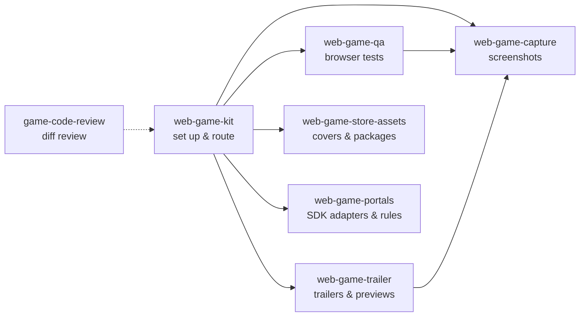

<p align="center">
  
</p>

<h1 align="center">Web Game Skills</h1>

<p align="center">
  <strong>Build it. Test it. Ship it to every portal.</strong><br>
  A complete Claude Code toolkit for building and shipping browser games — three.js, canvas, Vite — on game portals.
</p>

<p align="center">
  
  
  
  
</p>

<p align="center">
  
</p>

## The pipeline

One skill, one speciality — the kit routes each job to the right one:



## Skills

| Skill | What it does |
| --- | --- |
| [`web-game-kit`](skills/web-game-kit) | Entry point: sets up a game project in one command and routes work to the right skill |
| [`web-game-capture`](skills/web-game-capture) | Screenshots and browser control in muted headless Chrome: desktop, phones, tablets |
| [`web-game-qa`](skills/web-game-qa) | Browser test suites: smoke, devices, portal SDK integration against a fake SDK |
| [`web-game-trailer`](skills/web-game-trailer) | Frame-by-frame gameplay recording, trailers, portal preview videos |
| [`web-game-store-assets`](skills/web-game-store-assets) | Upload packages, covers, listing text, asset validation |
| [`web-game-portals`](skills/web-game-portals) | Platform layer and portal knowledge: CrazyGames (default), Y8, GamePix, Playgama, and a procedure for any other portal |
| [`game-code-review`](skills/game-code-review) | Review a diff of game code (web/three.js) for frame-path allocations, resource lifecycle, state bugs, and agent-written mistakes; severity-ranked report (adapted, MIT) |

## Install

```sh
gh repo clone eslamnegm010/web-game-skills ~/.web-game-skills
~/.web-game-skills/install.sh web-game        # the whole toolkit
```

Skills are linked into `~/.claude/skills/`, so an update is one command: `~/.web-game-skills/install.sh --update`. Start a new Claude Code session afterwards.

```sh
install.sh                      # list bundles and skills, and what is installed
install.sh <bundle|skill> ...   # install (requirements come along)
install.sh --all
install.sh --remove <skill> ...
install.sh --update             # git pull and relink
```

`--copy` copies instead of linking; `--force` replaces a same-named skill that came from elsewhere (the old one is moved to `~/.claude/skills-backup/`).

## Using the toolkit in a project

From the root of a Vite game project:

```sh
~/.claude/skills/web-game-kit/init-game.sh "Game Name" gamename_
```

That adds the platform layer (`src/platform/`), starter browser suites (`tools/e2e/`) and the store kit (`docs/store/`). Nothing is overwritten. Then ask Claude for what you need; the skills trigger on the task:

- "take a phone screenshot of the game" → `web-game-capture`
- "run the browser tests" → `web-game-qa`
- "make the preview videos" → `web-game-trailer`
- "package the build for CrazyGames and check the covers" → `web-game-store-assets`
- "add Poki" → `web-game-portals` researches the portal, writes its reference and scaffolds the adapter

## Design

- **Scripts stay in the skill; projects hold only what is theirs.** A project gets its tests, its trailer script and its platform layer (which ships with the game). Runners, drivers and fake SDKs are shared, so a fix reaches every project at once.
- **One skill, one speciality.** A skill that needs another says so in `skills.json`, and the installer brings it along.
- **Portals are adapters.** The game talks to one `platform` object; each portal is a file chosen at build time. CrazyGames is the default; a new portal starts with research and a written reference, not with code.
- **Everything is checked by a script where a script can check it** (asset sizes, video length, bundle limits, SDK calls) and says plainly what still needs a person's eye.

## Requirements

Node 22+, Google Chrome, `git`. For video: `ffmpeg`. For covers: Python 3 with Pillow (`python3` on macOS/Linux, `python` on Windows).

The scripts run on macOS, Linux and Windows. If a script answers "Permission denied" right after downloading or cloning, the copy lost its executable bit — run it as `bash <script>` instead (the scripts call each other that way internally, so only the first command needs it). On Windows, run the `.sh` scripts from **Git Bash** (it ships with [Git for Windows](https://gitforwindows.org/)) or from WSL — not from PowerShell or cmd. Chrome, Chromium and Edge are all found automatically. Two Windows notes: `install.sh` links skills into `~/.claude/skills` only when the shell may create symlinks (Developer Mode or an admin shell); otherwise it copies them and says so — re-run `install.sh --update` after a `git pull` in that case. And `package.sh` makes its zip with Windows' own `tar.exe` (or Python) when no `zip` command exists — never with PowerShell's `Compress-Archive`, whose entry names use backslashes and break uploads.

## Credits

`game-code-review` is adapted from [AlterLab GameForge](https://github.com/alterlab-ieu/alterlab_gameforge) (MIT — see the skill's `LICENSE`). Everything else is original work, extracted from the `agent-skills` collection as the standalone web-game set.
